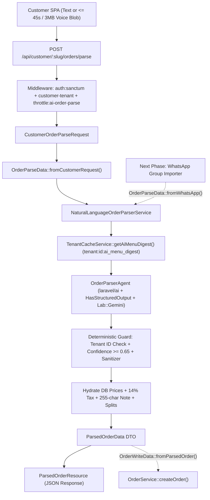

# Phase 1 Implementation Plan: AI Natural Language & Voice Order Parser (`laravel/ai`)

## Roadmap Overview
- **[COMPLETED] Step 1: Package & Menu Caching Foundation**
  - Installed `laravel/ai` (v0.11.3) with stateless architecture.
  - Configured `config/ai.php` and `.env.example` with Gemini 2.5 Flash and order parser timeouts/confidence limits.
  - Implemented `getAiMenuDigest(): array` and `getMenuItemsById(): array` in `TenantCacheService`.
  - Invalidation parity in `ItemService` (clears both `tenant:{id}:menu` and `tenant:{id}:ai_menu_digest`).
  - Tests verified: `TenantRedisCachingTest` (7 tests, 32 assertions).

- **[COMPLETED] Step 2: Shared DTOs & API Resource Layer**
  - Input: `app/DTOs/OrderParseData.php` + `app/DTOs/AudioPayload.php`.
  - Output: `app/DTOs/ParsedOrderData.php` + `app/DTOs/ParsePricing.php` + `app/DTOs/ParseMetadata.php`.
  - Order Pipeline Bridge: `app/DTOs/OrderWriteData.php::fromParsedOrder()`.
  - Serialization: `app/Http/Resources/ParsedOrderResource.php`.
  - Unit tests verified: `tests/Unit/ParsedOrderDtoTest.php` (6 tests, 31 assertions).

- **[COMPLETED] Step 3: AI Agent & Parsing Service**
  - `app/Ai/Agents/OrderParserAgent.php` (`implements Agent, HasStructuredOutput`).
  - `app/Services/NaturalLanguageOrderParserService.php` (Deterministic security, tenant cross-check, 14% VAT pricing, confidence filter, bill splitting).
  - Unit tests verified: `tests/Unit/NaturalLanguageOrderParserServiceTest.php` (10 tests, 71 assertions).

- **[COMPLETED] Step 4: Endpoint, Rate Limiting & Verification Tests**
  - Rate limiter `ai-order-parse` (10 req/min) in `AppServiceProvider`.
  - FormRequest: `app/Http/Requests/Customer/CustomerOrderParseRequest.php`.
  - Controller: `app/Http/Controllers/Api/Customer/CustomerOrderParseController.php`.
  - Route in `routes/api.php` under `auth:sanctum` + `customer-tenant` + `throttle:ai-order-parse`.
  - Feature test suite verified: `tests/Feature/CustomerOrderParseTest.php` (9 tests, 52 assertions).

---

## Architecture Overview



---

## Step 3 Detailed Specifications

### 1. `app/Ai/Agents/OrderParserAgent.php`
- First-party `laravel/ai` Agent implementing `Agent` and `HasStructuredOutput`.
- Attributes:
  - `#[Provider(Lab::Gemini)]`
  - `#[Model('gemini-2.5-flash')]`
  - `#[Temperature(0.1)]`
  - `#[Timeout(12)]`
- Constructor parameters:
  - `public readonly string $restaurantName`
  - `public readonly array $menuDigest`
- System Prompt / `instructions()`:
  - Injects compact menu digest (`id`, `name`, `category`, `price`, `description`).
  - Strict tenant ID rule: only match items from the provided menu digest.
  - Egyptian Arabic duals (e.g., "ساندوتشين" -> quantity 2, "كريبين" -> 2).
  - Franco-Arabic mapping (e.g., "2 burger w 1 batates").
  - Multi-person attribution ("El-Shilla"): attributes items to person names if present.
  - General kitchen notes vs per-item customizations.
- Fluent `schema(JsonSchema $schema)` returning:
  - `matched_items`: array of `{ id: int, name: string, quantity: int, note: ?string, person: ?string, confidence: float }`
  - `unmatched_items`: array of `{ raw_text: string, reason: string, candidate_matches: string[] }`
  - `notes`: string[] (general instructions)
  - `splits`: map of `person_name => { items: [...], subtotal: float }`
  - `language_detected`: string

### 2. `app/Services/NaturalLanguageOrderParserService.php`
- Uses `App\Traits\Calculation` for 14% VAT math (`$this->tax($subtotal)`).
- Dependencies: `TenantCacheService`, `TenantContext`.
- Core pipeline:
  1. Short-circuit on empty menu: If `getAiMenuDigest()` is empty, return empty `ParsedOrderData` with warning note.
  2. Prepare Audio / Text input: If `OrderParseData->hasAudio()`, convert via `Laravel\Ai\Files\Audio` (or audio prompt); if text, prompt directly.
  3. Invoke `OrderParserAgent::prompt($input)`.
  4. **Strict Security & Tenancy Guard**:
     - Check returned item IDs against `getMenuItemsById()`. Any ID not belonging to the current tenant is demoted to `unmatched_items` (`reason: 'not_on_menu'`).
     - Confidence guard: if confidence < 0.65 (`config('ai.order_parser.min_confidence')`), demote to `unmatched_items` (`reason: 'ambiguous'`).
  5. **Deduplication & Customization Formatting**:
     - Merge duplicate item IDs into single quantity sums.
  6. **Server-Authoritative Pricing**:
     - Pull authoritative `price` from DB item model (ignore any AI-generated prices).
     - Compute `subtotal = sum(unit_price * quantity)`.
     - Compute `tax = round($subtotal * 0.14, 2)`.
     - Compute `netTotal = subtotal + tax`.
  7. Construct and return `ParsedOrderData`.

---

## Step 4 Detailed Specifications

### 1. `app/Providers/AppServiceProvider.php`
Register rate limiter:
```php
RateLimiter::for('ai-order-parse', function (Request $request) {
    return Limit::perMinute(10)->by($request->user()?->id ?: $request->ip());
});
```

### 2. `app/Http/Requests/Customer/CustomerOrderParseRequest.php`
- Rules:
  - `text`: `nullable|required_without:audio|string|max:2000`
  - `audio`: `nullable|required_without:text|file|max:3072|mimetypes:audio/webm,audio/mp4,audio/ogg,audio/mpeg,audio/wav,video/webm`

### 3. `app/Http/Controllers/Api/Customer/CustomerOrderParseController.php`
- Invokable controller.
- Takes `CustomerOrderParseRequest`.
- Calls `NaturalLanguageOrderParserService::parse(OrderParseData::fromCustomerRequest($request))`.
- Returns `new ParsedOrderResource($parsedOrder)`.

### 4. `routes/api.php`
```php
Route::post('/orders/parse', CustomerOrderParseController::class)
    ->middleware('throttle:ai-order-parse');
```

---

## Verification & Commands
- Herd PHP path: `C:\Users\mazen_mostafa\.config\herd\bin\php84\php.exe`
- Format code: `vendor/bin/pint --dirty --format agent`
- Unit tests: `php artisan test --compact tests/Unit/NaturalLanguageOrderParserServiceTest.php`
- Full test suite: `php artisan test --compact`
