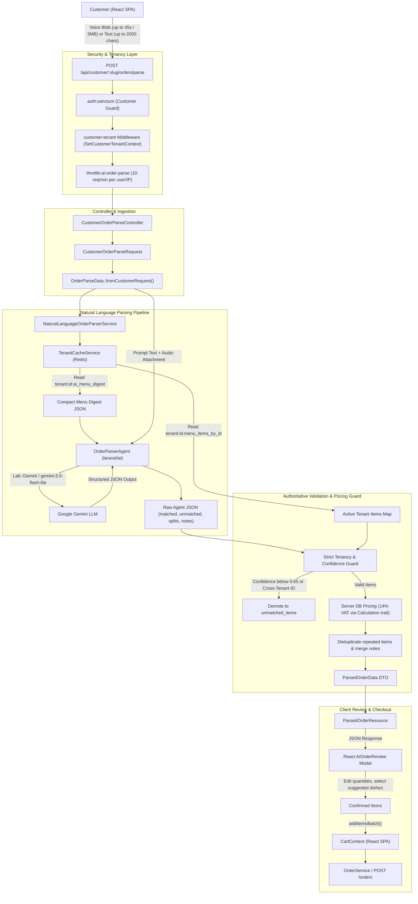

# AI Natural Language & Voice Order Parser (`laravel/ai`)

> **Audience:** Developers, AI coding agents, and technical operators. For the high-level system architecture, see [`docs/architecture.md`](./architecture.md). For agent instructions, see [`AGENTS.md`](../AGENTS.md).

---

## 1. Overview & Core Capabilities

The AI Natural Language & Voice Order Parser enables restaurant customers to place orders using spoken voice notes (up to 45 seconds / 3MB) or freeform natural language text in the React customer SPA. It translates colloquial Egyptian Arabic, Franco-Arabic (Arabizi), and English inputs into structured dishes with server-authoritative pricing and group bill splitting.

### Key Capabilities

- **Multilingual Spoken Speech & Audio**: Direct voice recording via browser `MediaRecorder` or text input. Supports Egyptian Arabic (اللهجة المصرية), Franco-Arabic (chat Arabic e.g. "2 burger w 1 batates"), and English.
- **Egyptian Arabic Duals & Slang**: Accurately recognizes dual grammar (المثنى) representing a quantity of 2 (e.g. "ساندوتشين" $\to$ 2, "كريبين" $\to$ 2, "كانزيتين" $\to$ 2) and regional food terms ("بطاطس", "صوابع", "كانز", "مية معدنية").
- **"El-Shilla" Group Bill Splitting**: Automatically attributes dishes to individual diners when names are mentioned in the prompt (e.g. "أحمد: 1 برجر، سارة: 2 كريب") and returns individual itemized breakdowns with per-person subtotals.
- **Note Differentiation**: Distinguishes per-item customizations (e.g. "من غير بصل", "extra cheese") from overall delivery/kitchen instructions (e.g. "خليه سخن", "رن الجرس لما توصل").
- **Strict Multi-Tenant Grounding**: The AI model is strictly grounded on the active restaurant's live menu digest. Any hallucinated, deleted, or cross-tenant item ID is demoted to unmatched items.
- **Server-Authoritative Pricing**: AI-reported prices are never trusted. Unit prices are retrieved directly from the tenant's database models, and Egyptian flat VAT (14%) is computed server-side via `App\Traits\Calculation`.

---

## 2. End-to-End System Architecture



---

## 3. The Backend Pipeline

### 3.1. Menu Caching Foundation (`TenantCacheService`)

To achieve low latency and minimal token usage, `TenantCacheService` generates and caches two specialized Redis representations per restaurant:

1. **AI Menu Digest (`tenant:{id}:ai_menu_digest`)**:
   - Compact JSON array containing only essential fields: `id`, `name`, `category`, `price`, and `description` (truncated to 140 chars).
   - Injected directly into the system prompt of `OrderParserAgent`.
2. **Menu Items Map (`tenant:{id}:menu_items_by_id`)**:
   - Collection of active `Item` models indexed by `id` for $O(1)$ database validation.
3. **Invalidation Parity**:
   - Whenever an item is created, updated, soft-deleted, or restored in `ItemService`, `TenantCacheService::forgetMenu($tenantId)` clears both keys alongside the public menu cache.

```php
// App\Services\TenantCacheService
public function getAiMenuDigest(): array
{
    $tenantId = $this->tenant->id();
    $ttl = $this->menuTtl(); // default 3600 seconds

    $fetch = static fn (): array => Item::query()
        ->select(['id', 'name', 'category', 'price', 'description'])
        ->orderBy('category')
        ->orderBy('name')
        ->get()
        ->map(static fn (Item $item): array => [
            'id' => (int) $item->id,
            'name' => (string) $item->name,
            'category' => (string) $item->category,
            'price' => (float) $item->price,
            'description' => $item->description ? (string) mb_substr((string) $item->description, 0, 140) : null,
        ])
        ->all();

    return $tenantId === null || $ttl <= 0
        ? $fetch()
        : Cache::remember($this->aiMenuDigestKey($tenantId), $ttl, $fetch);
}
```

### 3.2. Data Transfer Objects (DTO Layer)

The AI ordering system decouples HTTP requests, AI processing, and persistence through immutable readonly DTOs:

| DTO | Namespace | Responsibility |
|---|---|---|
| `OrderParseData` | `App\DTOs\OrderParseData` | Normalized parse request supporting text, audio payload, preferred language, and channel tag (`customer_web` or `whatsapp_group`). |
| `AudioPayload` | `App\DTOs\AudioPayload` | Encapsulates either an `UploadedFile` from a multipart upload or a base64 encoded audio string. |
| `ParsedOrderData` | `App\DTOs\ParsedOrderData` | Root parse result containing matched items, unmatched items, pricing, notes, and group splits. |
| `ParsePricing` | `App\DTOs\ParsePricing` | Server-calculated monetary amounts: `subtotal`, `tax` (14%), and `netTotal`. |
| `ParseMetadata` | `App\DTOs\ParseMetadata` | Parsing metadata: kitchen notes, El-Shilla `splits`, average confidence score, and detected language. |
| `OrderWriteData` | `App\DTOs\OrderWriteData` | Bridge DTO with factory `fromParsedOrder()` that maps parsed items directly into `OrderService::createOrder()`. |

### 3.3. AI Agent Specification (`OrderParserAgent`)

`OrderParserAgent` implements `Laravel\Ai\Contracts\Agent` and `Laravel\Ai\Contracts\HasStructuredOutput`:

- **Provider**: Google Gemini (`Laravel\Ai\Enums\Lab::Gemini`).
- **Model**: `gemini-3.5-flash-lite` (configurable via `AI_ORDER_PARSER_MODEL`).
- **Temperature**: `0.1` for deterministic, low-hallucination structured extraction.
- **Timeout**: Dynamic timeout (default 30 seconds for text, 60 seconds for audio).
- **System Instructions**:
  - Injects the ground-truth JSON menu digest.
  - Mandates strict adherence to provided menu item IDs.
  - Includes few-shot examples for Egyptian Arabic duals, Franco-Arabic transliterations, and multi-person bill splits.
  - Fluent JSON Schema enforcing typed arrays for `matched_items`, `unmatched_items`, `notes`, and `splits`.

### 3.4. Guard & Pricing Pipeline (`NaturalLanguageOrderParserService`)

The service runs a deterministic 7-step pipeline on raw AI output:

1. **Short-Circuit on Empty Menu**: Returns an empty `ParsedOrderData` if the tenant has no items on the menu.
2. **Audio/Text Attachment Prep**: Wraps uploaded audio using `Laravel\Ai\Files\Audio::fromPath()` or `Audio::fromBase64()`.
3. **Execution**: Prompts `OrderParserAgent`.
4. **Tenancy Cross-Check**: Every item in `matched_items` is verified against `getMenuItemsById()`. If an ID does not exist in the tenant's menu or belongs to a different `restaurant_id`, it is demoted to `unmatched_items` with reason `'not_on_menu'`.
5. **Confidence Filter**: Any item with confidence below `config('ai.order_parser.min_confidence')` (default `0.65`) is demoted to `unmatched_items` with reason `'ambiguous'`.
6. **Deduplication & Notes**: Repeated items with identical IDs are merged into single quantities, while item-specific notes are aggregated and formatted (e.g. "Ahmed: no onions, Mona: extra cheese").
7. **Server-Side Pricing**: Computes exact subtotal from database prices, adds 14% tax (`Calculation` trait), and produces `ParsedOrderData`.

---

## 4. API Reference

### Parse Customer Order

`POST /api/customer/{restaurant:slug}/orders/parse`

#### Middleware
- `auth:sanctum`: Customer authentication guard (`customer` provider).
- `customer-tenant`: Verifies `{restaurant:slug}` exists and matches the customer's `restaurant_id`.
- `throttle:ai-order-parse`: Rate limited to **10 requests per minute** per user ID (or client IP).

#### Request Headers
```http
Authorization: Bearer <sanctum_customer_token>
Accept: application/json
Content-Type: multipart/form-data
```

#### Request Payload (`CustomerOrderParseRequest`)
| Parameter | Type | Required | Constraints | Description |
|---|---|---|---|---|
| `text` | string | Optional* | Max 2000 chars | Freeform order description in Arabic, Franco, or English. |
| `audio` | file | Optional* | Max 3072 KB (3MB), mimetypes: `audio/webm,audio/mp4,audio/ogg,audio/mpeg,audio/wav,video/webm` | Spoken audio recording (recommended $\le$ 45s). |
| `preferred_language` | string | Optional | Max 20 chars | Optional hint (e.g. `ar_eg`, `en`, `franco`). |

*\*At least one of `text` or `audio` must be provided (`required_without`).*

#### Success Response (`200 OK`)
```json
{
  "items": [
    {
      "id": 14,
      "name": "Classic Cheeseburger",
      "quantity": 2,
      "price": "120.00",
      "subtotal": "240.00",
      "note": "no onions"
    },
    {
      "id": 22,
      "name": "French Fries",
      "quantity": 1,
      "price": "45.00",
      "subtotal": "45.00",
      "note": null
    }
  ],
  "unmatched": [
    {
      "raw_text": "سوشي",
      "reason": "not_on_menu",
      "candidate_matches": []
    }
  ],
  "note": "خليه سخن لو سمحت | Classic Cheeseburger: no onions",
  "subtotal": "285.00",
  "tax": "39.90",
  "net": "324.90",
  "splits": {
    "Ahmed": {
      "items": [
        {
          "id": 14,
          "name": "Classic Cheeseburger",
          "quantity": 1,
          "unit_price": 120.0,
          "subtotal": 120.0
        }
      ],
      "subtotal": 120.0
    },
    "Mona": {
      "items": [
        {
          "id": 14,
          "name": "Classic Cheeseburger",
          "quantity": 1,
          "unit_price": 120.0,
          "subtotal": 120.0
        },
        {
          "id": 22,
          "name": "French Fries",
          "quantity": 1,
          "unit_price": 45.0,
          "subtotal": 45.0
        }
      ],
      "subtotal": 165.0
    }
  }
}
```

#### Error Responses
| HTTP Code | Condition | JSON Response |
|---|---|---|
| `401 Unauthorized` | Missing token or customer does not belong to `{restaurant:slug}` | `{"message": "Unauthenticated."}` |
| `404 Not Found` | Restaurant slug does not exist or restaurant is inactive | `{"message": "Restaurant not found or inactive."}` |
| `422 Unprocessable` | Neither text nor audio sent, or audio file format/size invalid | `{"message": "The text field is required when audio is not present.", "errors": {...}}` |
| `429 Too Many Requests` | Exceeded 10 requests / minute rate limit | `{"message": "Too Many Attempts."}` |
| `503 Service Unavailable` | LLM provider overloaded (`ProviderOverloadedException`) | `{"message": "AI service is currently busy. Please try again later."}` |
| `504 Gateway Timeout` | LLM provider network connection timed out (`ProviderConnectionException`) | `{"message": "AI service timed out. Please try again."}` |

---

## 5. Frontend Implementation (React SPA)

The customer frontend lives in `resources/js/customer-app/`:

### 5.1. Component Hierarchy
- `AiOrderModal.jsx`: Modal controller managing the parse lifecycle:
  1. **Authentication Check**: Renders `AiAuthGate` if the user is a guest.
  2. **Input Mode**: Renders `AiOrderPromptForm` with Text and Voice tabs, active recording status, and localized example chips.
  3. **Review Mode**: Renders `AiOrderReview` once parsed results return.
- `AiOrderPromptForm.jsx`: Textarea with localized prompt chips (Egyptian Arabic, Franco-Arabic, El-Shilla Split) and the voice recorder widget.
- `VoiceRecorderWidget.jsx`: Visual recording widget showing audio waveform, duration timer, and start/stop/reset actions.
- `useVoiceRecorder.js`: Custom hook utilizing the browser `MediaRecorder` API. Enforces a 45-second hard stop and generates WebM/WAV audio blobs with proper MIME types.
- `AiOrderReview.jsx`:
  - **Matched Dishes**: Editable item rows with `+` / `-` quantity controls and per-item notes.
  - **Unmatched Dishes**: Displays unrecognized requests with suggested candidate dishes ("Did you mean...?"). Clicking a candidate adds it to the order.
  - **Kitchen Note Editor**: Editable unified kitchen note.
  - **GroupBillSplitCard.jsx**: Renders itemized per-person breakdown cards with individual subtotals.
  - **Action Buttons**: "Add to Cart" or "Checkout Now".
- `CartContext.jsx`: Provides `addItemsBatch(items, { note, splits })` to insert reviewed dishes into the shopping cart.

---

## 6. Configuration & Environment Variables

Add the following keys to `.env` (refer to `.env.example`):

```dotenv
# Google Gemini API Key for Laravel AI SDK
GEMINI_API_KEY=your_gemini_api_key_here

# Default AI Provider
AI_DEFAULT_PROVIDER=gemini

# Model for Order Parsing (gemini-3.5-flash-lite or gemini-2.5-flash)
AI_ORDER_PARSER_MODEL=gemini-3.5-flash-lite

# Confidence Threshold (matches below this are marked ambiguous)
AI_ORDER_MIN_CONFIDENCE=0.65

# Audio Constraints
AI_ORDER_MAX_AUDIO_SECONDS=45
AI_ORDER_MAX_AUDIO_KB=3072

# Timeouts (in seconds)
AI_ORDER_TIMEOUT_SECONDS=30
AI_ORDER_AUDIO_TIMEOUT_SECONDS=60
AI_ORDER_CONNECT_TIMEOUT_SECONDS=10
```

---

## 7. Testing & Verification

Automated tests cover all layers of the AI order parsing pipeline without calling live external AI APIs:

```bash
# Run AI Order Parser unit tests (DTOs & Service logic)
php artisan test --compact tests/Unit/ParsedOrderDtoTest.php tests/Unit/NaturalLanguageOrderParserServiceTest.php

# Run AI Order Parser feature & API tests
php artisan test --compact tests/Feature/CustomerOrderParseTest.php

# Run Tenant Redis Caching tests
php artisan test --compact tests/Feature/TenantRedisCachingTest.php

# Run Full Test Suite
php artisan test --compact
```

### Mocking in Tests

Use `OrderParserAgent::fake()` to stub model responses in tests:

```php
use App\Ai\Agents\OrderParserAgent;

OrderParserAgent::fake([
    [
        'matched_items' => [
            [
                'id' => $item->id,
                'name' => $item->name,
                'quantity' => 2,
                'note' => 'no onions',
                'person' => 'Ahmed',
                'confidence' => 0.98,
            ],
        ],
        'unmatched_items' => [],
        'notes' => ['Extra napkins'],
        'splits' => [
            'Ahmed' => [
                'items' => [['id' => $item->id, 'quantity' => 2, 'unit_price' => 100.0, 'subtotal' => 200.0]],
                'subtotal' => 200.0,
            ],
        ],
        'language_detected' => 'ar_eg',
    ],
]);
```
