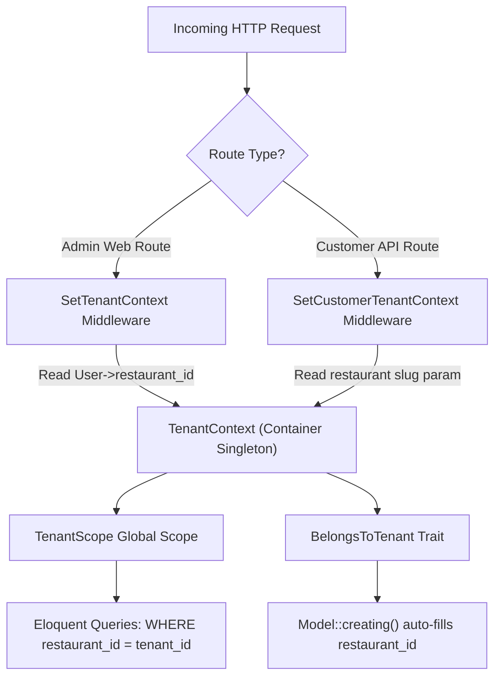

# System Architecture & Technical Design

> **Audience:** Software engineers, architects, and technical contributors. For AI agent directives and strict constraints, see [`AGENTS.md`](../AGENTS.md). For AI order parsing details, see [`docs/ai-ordering.md`](./ai-ordering.md).

---

## 1. Executive Summary

aklaSaaS is a **multi-tenant Laravel 13 SaaS application for restaurants**. A single application instance serves multiple independent restaurant organizations. Each restaurant operates with isolated staff members, customer bases, menus, categories, and order workflows.

The application serves two distinct user populations through two dedicated frontends:
1. **Restaurant Staff & Administration**: Managed via a server-rendered Blade administrative dashboard at `/`.
2. **Restaurant Diners & Customers**: Served via a client-side React single-page application (SPA) routed under `/{restaurant:slug}/...`.
3. **AI Natural Language Ordering Subsystem**: An integrated AI engine powered by `laravel/ai` and Google Gemini that allows end customers to place orders via voice notes and freeform text with automatic bill splitting.

---

## 2. Multi-Tenancy Architecture

The core tenet of aklaSaaS is **strict tenant isolation**.



### 2.1. The Tenant Singleton (`TenantContext`)

`App\Services\TenantContext` is registered as a scoped singleton in `AppServiceProvider`. It holds the resolved `Restaurant` model for the duration of the request lifecycle:
- `$tenantContext->set(Restaurant $restaurant)`: Establishes the current tenant.
- `$tenantContext->get(): ?Restaurant`: Retrieves the active restaurant.
- `$tenantContext->id(): ?int`: Returns the active tenant's primary key.

### 2.2. Global Tenant Scoping (`BelongsToTenant` & `TenantScope`)

All tenant-owned models (`User`, `Customer`, `Item`, `Order`, `Attachment`) include the `App\Traits\BelongsToTenant` trait. This trait:
1. Registers `App\Models\Scopes\TenantScope` as a global query scope, appending `WHERE restaurant_id = {$tenantId}` to all queries when a tenant is active in `TenantContext`.
2. Automatically populates `restaurant_id` on model creation if not explicitly set.

### 2.3. Tenant Resolution Middlewares

- **`SetTenantContext`**: Applied to staff web routes (`routes/web.php`). Resolves `restaurant_id` from the authenticated `User` (`$request->user()->restaurant_id`).
- **`SetCustomerTenantContext`**: Applied to customer API routes (`routes/api.php`). Resolves the restaurant via `{restaurant:slug}`. It also enforces cross-tenant security: if the customer is authenticated, their `restaurant_id` **must match** the resolved restaurant's ID, returning `401 Unauthorized` on mismatch.

---

## 3. Two Populations, Two Guards, Two Frontends

To ensure total isolation, staff users and customers belong to separate tables, authentication guards, and session configurations:

| Dimension | Administrative Staff | Customer / Diner |
|---|---|---|
| **Model** | `App\Models\User` | `App\Models\Customer` |
| **Authentication Guard** | `web` (Session / Cookie) | `customer` / `auth:sanctum` |
| **Frontend Stack** | Blade Templates + Tailwind CSS 4 + Alpine/Vanilla JS | React 19 SPA mounted in `spa.blade.php` |
| **Routing** | `routes/web.php` (prefix `/` under `auth` + `tenant`) | `routes/api.php` under `/api/customer/{restaurant:slug}` |
| **Tenant Identifier** | `auth()->user()->restaurant_id` | `{restaurant:slug}` route parameter |
| **Roles / Permissions** | Spatie Roles: `Admin`, `Employee` | None (end-consumer) |

> [!IMPORTANT]
> A `User` can never be a `Customer`, and a `Customer` can never log in through the admin `web` guard. They only share a reference to `Restaurant`.

---

## 4. Spatie Roles & Permissions System

Role-based access control (RBAC) for restaurant staff is powered by `spatie/laravel-permission`.

### Roles

1. **`Admin`**:
   - Full menu management: create, read, edit, delete, and restore items.
   - Order management: create orders, edit existing orders, cancel/delete orders.
   - Business analytics: access `/dashboard` with revenue and performance metrics.
2. **`Employee`**:
   - Order intake: take new walk-in and phone orders (`/orders/create`, `/orders/store`).
   - Customer lookup: search customers and quick-register walk-in diners.
   - Menu viewing: browse active dishes (`/items/index`, `/items/show`).
   - Restricted from editing menu pricing or deleting completed orders.

### Enforcement

Middleware declarations in `routes/web.php` enforce role authorization using the alias `role:Admin`:

```php
Route::prefix('items')->name('items.')->group(function () {
    Route::get('/index', [ItemController::class, 'index'])->name('index');
    Route::get('/create', [ItemController::class, 'create'])->name('create');
    Route::post('/items', [ItemController::class, 'store'])->name('store');
    Route::get('/show/{item}', [ItemController::class, 'show'])->name('show');

    Route::middleware('role:Admin')->group(function () {
        Route::get('/edit/{item}', [ItemController::class, 'edit'])->name('edit');
        Route::put('/{item}', [ItemController::class, 'update'])->name('update');
        Route::delete('/delete/{item}', [ItemController::class, 'delete'])->name('delete');
        Route::post('/restore/{item}', [ItemController::class, 'restore'])->name('restore');
    });
});
```

---

## 5. Order Lifecycle & Financial Calculations

### 5.1. Centralized Order Pipeline (`OrderService`)

All order creation and modification logic—whether triggered by staff in Blade, customers in the React SPA, or the AI parser—delegates to `App\Services\OrderService`:
- Generates prefixed order numbers (`ORD-` for staff, `C-` for customer SPA, `AI-` for AI parsed orders).
- Validates active item existence within the tenant boundary.
- Executes database transactions attaching line items into `order_items`.

### 5.2. Financial Calculations (`Calculation` Trait)

All pricing calculations are server-authoritative. The client transmits item IDs and integer quantities, never prices:
- **Tax Rate**: Flat 14% Egyptian Value Added Tax (VAT).
- **Subtotal**: $\sum (\text{unit\_price} \times \text{quantity})$.
- **Tax Calculation**: $\text{round}(\text{subtotal} \times 0.14, 2)$.
- **Net Total**: $\text{subtotal} + \text{tax}$.
- **Database Types**: `decimal(10, 2)` across `items`, `orders`, and `order_items`.

---

## 6. Database Schema & Multi-Tenant Migrations

All tenant tables include `restaurant_id` with foreign key constraints and compound indexing:

```
restaurants
├── id (PK)
├── name (string)
├── slug (string, unique)
├── email (string)
├── is_active (boolean)
└── timestamps

users (Staff)
├── id (PK)
├── restaurant_id (FK -> restaurants.id, ON DELETE CASCADE)
├── name (string)
├── email (string, unique)
├── password (string)
└── timestamps

customers (Diners)
├── id (PK)
├── restaurant_id (FK -> restaurants.id, ON DELETE CASCADE)
├── name (string)
├── email (string)
├── phone_number (string)
├── password (string)
└── timestamps
└── UNIQUE (restaurant_id, email)
└── UNIQUE (restaurant_id, phone_number)

items (Menu)
├── id (PK)
├── restaurant_id (FK -> restaurants.id, ON DELETE CASCADE)
├── name (string)
├── price (decimal 10,2)
├── category (enum: Food, Beverage, Dessert)
├── description (text, nullable)
├── deleted_at (soft deletes)
└── timestamps
└── INDEX (restaurant_id, category)

orders
├── id (PK)
├── restaurant_id (FK -> restaurants.id, ON DELETE CASCADE)
├── user_id (FK -> users.id, nullable)
├── customer_id (FK -> customers.id, nullable)
├── order_number (string)
├── type (enum: dine_in, take_away, delivery)
├── sub_total (decimal 10,2)
├── tax (decimal 10,2)
├── net (decimal 10,2)
├── note (string 255, nullable)
└── timestamps
└── INDEX (restaurant_id, created_at)

order_items
├── id (PK)
├── order_id (FK -> orders.id, ON DELETE CASCADE)
├── item_id (FK -> items.id)
├── quantity (integer)
├── price (decimal 10,2)
├── sub_total (decimal 10,2)
└── timestamps
```

---

## 7. Real-Time Broadcasting (Laravel Reverb)

Menu inventory and item modifications are broadcast in real time across connected customer SPAs and staff dashboards using Laravel Reverb:
- **Event**: `App\Events\ItemUpdateEvent`.
- **Channel**: Public channel scoped by restaurant `restaurant.{slug}.items`.
- **Trigger**: Dispatched automatically in `ItemService` upon dish creation, update, or status changes.

---

## 8. High-Performance Caching Layer (`TenantCacheService`)

`TenantCacheService` abstracts Redis cache storage with strict tenant key prefixes:
- `tenant:{id}:menu`: Cached categorized menu payload for the customer SPA (`menuTtl()`, default 3600s).
- `tenant:{id}:dashboard`: Cached administrative KPI metrics (`dashboardTtl()`, default 60s).
- `tenant:{id}:ai_menu_digest`: Compact JSON menu used for AI prompt injection.
- `tenant:{id}:menu_items_by_id`: Active item models indexed by ID for $O(1)$ AI validation.

**Cache Invalidation**: Handled deterministically in `ItemService` via `TenantCacheService::forgetMenu($tenantId)` on every menu write operation.

---

## 9. AI Natural Language Ordering Subsystem

The AI Ordering Subsystem integrates `laravel/ai` with Google Gemini 3.5 Flash Lite / 2.5 Flash to enable voice and text order parsing:
- **Agent**: `App\Ai\Agents\OrderParserAgent`.
- **Service**: `App\Services\NaturalLanguageOrderParserService`.
- **Security**: The AI prompt is strictly grounded with the tenant's AI menu digest. Cross-tenant item IDs and ambiguous matches ($< 0.65$ confidence) are demoted to unmatched items.
- **Group Splitting**: Automatically extracts individual diner requests ("El-Shilla" split).
- **Endpoint**: `POST /api/customer/{restaurant:slug}/orders/parse` (rate-limited to 10 req/min).

For the complete implementation, prompt engineering, and UI details, refer to [`docs/ai-ordering.md`](./ai-ordering.md).
